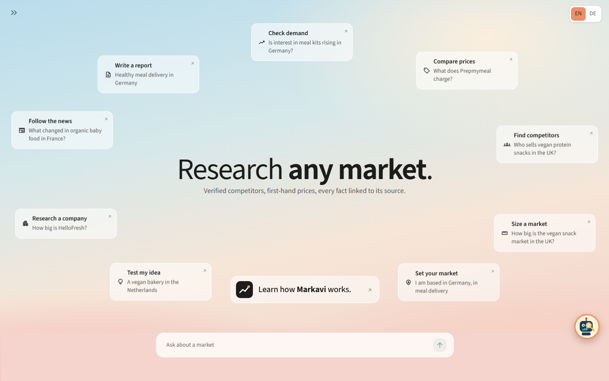
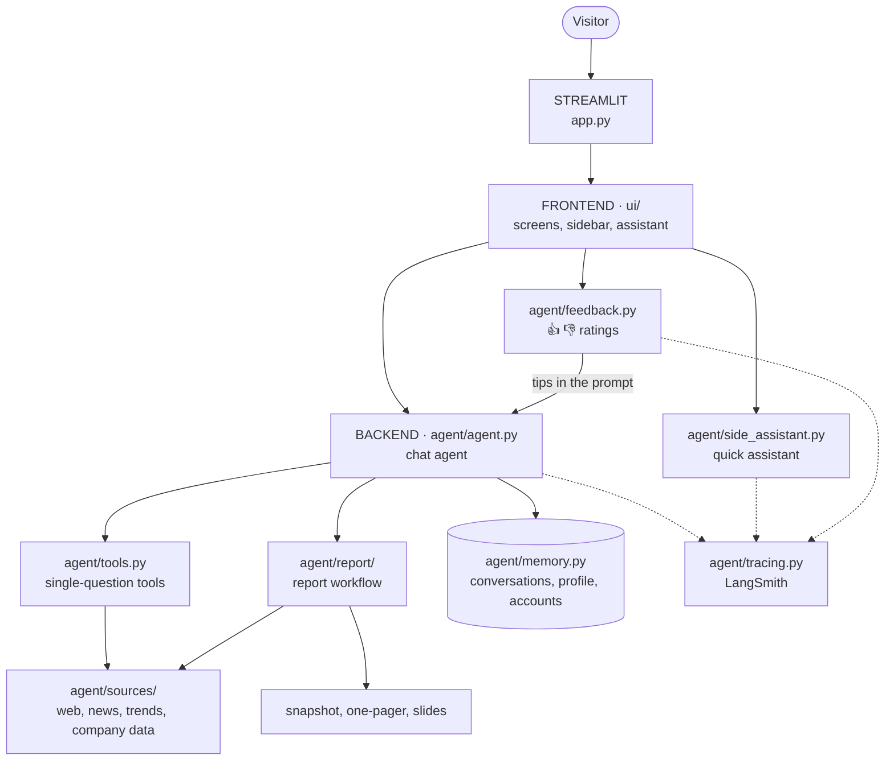

#  Markavi

**Your AI market research assistant: verified competitors, first-hand prices, every fact linked to its source.**

[](https://github.com/Anusha-3109/market-research-assistant/actions/workflows/tests.yml) [](https://github.com/Anusha-3109/market-research-assistant/actions/workflows/deploy.yml)

Markavi researches a market for a first-time founder: it finds the real competitors in a country, reads their prices from their own websites, collects market figures, news and demand trends, and writes a six-section report in which every fact links to its source. It pauses so you can review the competitor list, and asks before it saves a file. It is built with LangChain, LangGraph, OpenRouter (GPT-4.1 mini by default) and Streamlit, and combines a ReAct agent with a fixed report workflow, memory and human-in-the-loop approval.

The Sprint 3 task description is in [`135.md`](135.md).



## Contents

- [Purpose](#purpose)
- [What it does](#what-it-does)
- [Quick start](#quick-start)
- [How to use it](#how-to-use-it)
- [Example use cases](#example-use-cases)
- [How it works](#how-it-works)
- [Technical decisions](#technical-decisions)
- [Observability](#observability)
- [Error handling and safety](#error-handling-and-safety)
- [Tests](#tests)
- [Deployment](#deployment)
- [Project structure](#project-structure)
- [Known limitations](#known-limitations)
- [What I would improve](#what-i-would-improve)

## Purpose

### Target user

First-time founders who want to test a business idea before launch and
cannot afford an analyst or paid research reports. Also useful for small
business owners who are considering a new product or a new region.

### Problem

Before launching, a founder needs to understand competitors, pricing,
customer needs and market trends. Today this means searching many
websites by hand, copying notes into a document, and trying to make sense
of them. It takes days, the result is unstructured, and it is often
unclear where each number came from.

### Solution

An AI agent that takes a product and a target country, searches live web
and news sources, verifies which companies really compete in that country,
reads their prices first-hand, and produces a structured report in which
every fact has a reference. The SWOT is analysis built on those facts and
is labelled as such. The user can then ask follow-up questions.

### Why an agent

- The research needs current data, which a language model alone does not
  have.
- The data comes from several sources: web search, news, company websites,
  company financials and search-interest data.
- Each step depends on the previous one: the competitors have to be found
  before anything can be looked up about each of them.

A single prompt cannot do this because it has no live data. Plain RAG
cannot do it because there is no fixed set of documents to search. An
agent with tools can decide what to look up next.

## What it does

| Capability | Detail |
|---|---|
| Web app | Example cards to start from, then three views of a conversation: Snapshot (a report's key figures at a glance), Ask (the chat) and Report (the report as cards) |
| Market research report | Six fixed sections: market overview, competitors, pricing, trends, SWOT analysis, references |
| Verified competitors | Each candidate is checked: does it sell this product, in this country? Others are dropped with the reason |
| First-hand prices | Read only from the competitor's own website; the source link is set by code |
| Follow-up questions | Answered with single tools: search, news, page reader, demand trend, company figures |
| Your review | The agent pauses so you can approve, remove or add competitors, or cancel |
| Save with approval | A report is written to a file only after you approve, and you can change the title |
| Memory | Remembers the conversation across restarts, and your country, industry and idea across conversations |
| Numbered sources | Every link in an answer becomes a number such as [1]; the source list shows each page's title and site, and marks a company's own site as Official |
| Download | Any answer as a Markdown file or a PDF |
| Report formats | A report as the full text, as an investor one-pager, or as pitch deck slides with a PowerPoint download |
| Language | An EN / DE switch at the top right, saved with the account. In German the views, the answers and the reports (also as one-pager, slides, Markdown and PDF) are in German |
| Assistant | A small chat at the bottom right of every view for a quick question in between, answered from the open report |
| Stop | A run can be stopped; what was found so far is kept and the conversation continues |
| Resilience | Every data source has a free backup, so one outage does not stop a report. If the model leaves out a required field, the question is asked again instead of losing the report |
| Accounts | On a deployed copy each person signs in to their own account, with their own conversations, remembered profile, settings and saved reports |
| Cost shown | Every answer and report shows what its model calls cost, as reported by the model service |
| Tracing | With a LangSmith key, every run is recorded step by step for debugging |
| Feedback loop | 👍 / 👎 under every answer; a 👎 asks what could be better (six reasons and a comment). A reason an account gives again and again becomes a tip in that account's system prompt, and every rating is added to the answer's LangSmith trace |
| Pages | Links at the top of the sidebar to Research, a **Dashboard** (requests, wait, tokens, cost, tool calls and the share rated helpful) and **Admin** |
| Admin page | Developer settings for the whole app: model, temperature, answer length and style, competitor review, the system prompt, and a switch for each tool. A Feedback tab shows how answers were rated and why, which settings did best, and the latest 👎, with a switch for learning from feedback. Its Documentation tab explains how it works (the flow as a Mermaid chart, the tools and data sources). Only admins see it |
| Light and dark | A Light / Dark choice on the Admin page, for the whole app |
| Deployed | Runs on Google Cloud Run behind a sign-in screen, and redeploys itself after the tests pass |

The assistant does **not** give investment or financial advice, invent or
estimate numbers, use paid databases, or answer questions unrelated to
market research.

## Quick start

Requirements: Python 3.10 or newer, and two API keys.

| Key | Used for | Where to get it |
|---|---|---|
| `OPENROUTER_API_KEY` | The language model | https://openrouter.ai/keys |
| `TAVILY_API_KEY` | Web search, news and page reading | https://tavily.com (free tier) |

```bash
git clone <this repository>
cd market-research-assistant

python -m venv .venv
.venv\Scripts\Activate.ps1          # Windows PowerShell
# source .venv/bin/activate         # macOS and Linux

pip install -r requirements.txt

copy .env.example .env              # then open .env and paste your two keys
```

Start the app:

```bash
streamlit run app.py
```

It opens in your browser at `http://localhost:8501`. If a key is missing,
the page shows setup instructions.

A report costs about three cents of OpenRouter credit (measured: $0.03 for
23 model calls) and about 20 Tavily searches. A single question costs a
fraction of a cent. The app shows the exact figure next to every answer.

## How to use it

1. **Ask.** Click an example card on the start screen, or type a question
   that names a product and a country: *healthy meal delivery in Germany*.
2. **Review.** A report pauses once so you can approve or edit the list of
   competitors it found.
3. **Read.** A finished report has three views: **Snapshot** (the key
   figures in tabs), **Ask** (the chat) and **Report** (each section as a
   card, also as an investor one-pager or pitch deck slides).
4. **Take it with you.** Download as Markdown, PDF or PowerPoint, or save
   it to the reports folder after you approve.
5. **Ask in between.** The robot icon at the bottom right opens a small
   assistant for quick questions about the open report. The **EN | DE**
   switch at the top right changes the language.

The full guide, with every screen and setting, is in
[`docs/how-to-use.md`](docs/how-to-use.md).

## Example use cases

Markavi handles a full report, single questions, and the cases where it
should not answer:

- *"Give me a market research report for healthy meal delivery in
  Germany."* It runs the report workflow and pauses for your review.
- *"Is there a market for vegan protein snacks?"* No country was given, so
  it asks which one you mean.
- *"Should I invest my savings in this business?"* It declines to give
  investment advice and offers market facts instead.

All seven examples are in
[`docs/example-use-cases.md`](docs/example-use-cases.md).

## How it works

Markavi has three parts. A **chat agent** (a ReAct agent built with
LangChain) answers single questions with tools for prices, competitors,
news, demand and company figures. A **report workflow** (a fixed LangGraph
graph) writes the six-section report: code decides the order of the steps
and checks every result, and the model does one small job at a time. The
**web app** (Streamlit) shows the work as it happens and holds the two
points where a person approves: the competitor list and saving a file.
Conversations, the remembered profile and accounts are kept in a memory
file, and every source has a fallback.

Answers improve from people's ratings. A 👎 asks what could be better; a
reason that comes up in two or more of an account's last ten ratings adds a
fixed tip to that account's system prompt, such as "Keep answers short".
Only these fixed sentences reach the prompt, never a typed comment. The
Admin page shows what was rated down, to guide changes for everyone.

The parts in detail, with the data sources, middleware, approval steps and
the feedback loop, are in [`docs/how-it-works.md`](docs/how-it-works.md).

## Technical decisions

The main decision is a fixed workflow for reports and a free agent for
conversation. The first version let one agent do everything; it skipped
steps, listed US companies as German competitors and took prices from an
old article, and each prompt fix produced a new error. Moving the report
into a workflow where code controls the order and checks every result
fixed that, and the free agent is kept for what it is good at. The other
decisions follow the same idea: let code do what must be exact (numbers,
sources, the report text) and let the model do what needs judgment.

Every decision, with what was tried first and why it changed, is in
[`docs/technical-decisions.md`](docs/technical-decisions.md).

## Observability

Every run can be sent to [LangSmith](https://smith.langchain.com) as a
trace: each call to the model, each tool call and each step of the report
workflow, with how long it took, its tokens and cost, and any error. A
trace answers "why did the agent do that?" after the fact.

| | |
|---|---|
| Switching it on | Set `LANGSMITH_API_KEY` in `.env`. Without a key nothing is sent. `LANGSMITH_TRACING=false` switches it off with the key in place |
| EU accounts | Also set `LANGSMITH_ENDPOINT=https://eu.api.smith.langchain.com` |
| Projects | A copy on your own computer traces to `markavi-local`, the deployed copy to `markavi-live`, so experiments and visitors' runs are not mixed. `LANGSMITH_PROJECT` names another |
| Names | A chat turn is the run "Markavi chat"; a report's steps appear inside the turn that asked for it. The assistant's calls are "Markavi assistant" |
| Labels | The conversation id (LangSmith groups a conversation by it), the account's internal id, the model and the language |
| Ratings | A 👍 or 👎 is added to the answer's trace as feedback `user_rating` (1 or 0), with the reasons and the comment, so traces can be filtered by it. Rating again replaces it |
| In the app | The Help panel says whether runs are traced |
| Tests | Never trace: `tests/conftest.py` switches tracing off before anything is loaded |

A trace holds the questions people typed and the answers. It is labelled
with the account's internal id only, never a name or an email address. The
code is in `agent/tracing.py`.

## Error handling and safety

- **Failures are explained, not shown raw.** A missing key, a rate limit,
  a timeout or a failed source each get a plain message; a source that
  fails is replaced by the next one, and what cannot be found is reported
  as "not found".
- **Web content is treated as information, never as instructions.** Only
  `http` and `https` pages are opened, and private network addresses are
  blocked.
- **Nothing is written without approval,** and only into `reports/`.
- **A deployed copy** asks for a sign-in first, stores passwords only as
  salted hashes, and gives each account only its own conversations.
- **Boundaries.** Investment advice and off-topic requests are declined.

The full list is in
[`docs/error-handling-and-safety.md`](docs/error-handling-and-safety.md).

## Tests

```bash
pytest
```

1040 tests, none of which use the internet or cost anything: the
model and the outside services are replaced with fakes. They run on every
push, and the app is deployed only when they pass.

What each test file covers is in [`docs/tests.md`](docs/tests.md).

## Deployment

Markavi runs on **Google Cloud Run**: <https://markavi-1037824678664.europe-west1.run.app>. It asks you to sign in
first, and creating an account needs an invite code, so that a stranger
with the link cannot spend the API credit. A push to `main` runs the tests
and then deploys by itself; the keys live in Secret Manager, never in the
image.

How it is set up, its settings, and how to deploy it yourself are in
[`docs/deployment.md`](docs/deployment.md).

## Project structure

```
MARKET-RESEARCH-ASSISTANT
│
├── FRONTEND             ui/
│   ├── screens          start, pickers, guide, the three views, sign-in
│   ├── on every screen  sidebar, assistant, account badge, language switch
│   └── look and words   static/ (CSS, HTML, scripts) and words/ (English, German)
│
├── BACKEND              agent/
│   ├── chat agent       the agent, its prompt, tools and approval points
│   ├── report/          the report workflow (LangGraph)
│   ├── sources/         one file per outside service, with fallbacks
│   ├── memory           conversations, profile, accounts
│   ├── feedback         ratings, tips from ratings, ratings to LangSmith
│   └── outputs          citations, PDF, PowerPoint, report check
│
├── STREAMLIT            app.py, .streamlit/
│
└── tests/ · docs/ · Dockerfile · .github/workflows/
```

The words in capitals are groups; the real folders are `ui/` and `agent/`.

How the parts work together:



Every file, with what it is for, is in
[`docs/project-structure.md`](docs/project-structure.md).

## Known limitations

**Token usage and cost**

- Only model calls are counted. Web searches and page reading are billed by
  Tavily in its own credits; a report uses about 20 searches.
- A report written before this feature shows the chat part only, and says
  so. The workflow's calls were not recorded then.
- A run that was stopped shows what had been saved up to the stop. A model
  call that was in progress at that moment may be missing.

**Feedback loop**

- Learning is a fixed rule, not training: five set tips, switched on by
  repeated reasons. The model itself does not change, and nothing new is
  learned from a typed comment.
- The tips reach chat answers only. The report workflow sets its own length
  and sources and is not changed by them.
- Whether the tips make answers better is not measured. That needs an
  evaluation set (see "What I would improve").
- The settings kept with a rating are the ones in use when it was given,
  which is nearly always what the answer was written with.
- Questions and comments are kept with the ratings, and with tracing on
  they are also sent to LangSmith. Personal data typed into a comment is
  stored there too.
- A rating that fails to reach LangSmith is not sent again; it is still
  saved in the app.
- Each account can rate as often as it likes, so one active account can
  tip the figures on the Admin page.

**Maximum answer length**

- The limit counts tokens, so the word counts next to each position are
  approximate and differ between languages and models.
- An answer that reaches the limit stops in the middle of a sentence. It is
  marked as cut off, not completed.
- The limit was tried with the default model. The two other models in the
  settings are reached through the same service and should behave the same,
  but that was not checked.

**Answer styles**

- A style's wording is followed by the model, not enforced by code. Only
  one part is enforced: a missing source link is put back by the source
  check.
- The source check adds the pages the tools reported, not the exact page
  behind each sentence. After a search that is up to five pages, and the
  answer may rest on only one of them.
- It checks whether an answer has any link at all. An answer with one link
  and one unsourced figure passes.
- Whether an answer "sounds formal" is not tested automatically; it was
  judged by reading real answers.
- The styles were tried with the default model. The other two models in the
  settings may follow them more or less closely.

**The deployed copy**

- Signing in lasts for one browser session. A refresh of the page signs
  you out.
- An account cannot be deleted from the app.
- An email address is not verified. A mistyped one means the link for a
  forgotten password never arrives; it can be corrected on the sign-in
  page by someone who still knows the password.
- An account made before email was added has no address until its owner
  adds one, and cannot reset a forgotten password until then.
- Changing a password does not sign out other browsers where the account
  is open; they stay in until closed or refreshed.
- Email sent from a personal mail account can land in the spam folder.
- Email addresses are personal data. They are stored with the accounts in
  the bucket, readable by the author of the app.
- Everyone who has the invite code can create any number of accounts, and
  all accounts spend the same API credit. There is no limit per account.
- The author of the app, who can read the bucket, can read every
  account's conversations. They are separated from each other, not
  encrypted.
- Wrong tries are counted per username, so someone who knows a username
  can make its owner wait a minute by guessing five times.
- The first visit after a quiet period takes several seconds, while the
  service starts.
- A deploy, or the service shutting down while idle, signs everyone out.
- If the service stops in the middle of an answer, that answer is lost.

**The three views and the converted figures**

- A report written before the Snapshot view existed has no saved figures,
  so it has no Snapshot. The figures cannot be rebuilt afterwards.
- A Snapshot saved before all four parts of the SWOT were kept shows only
  the parts it has, usually the opportunities alone.
- There is no tab about customers: the report does no customer research.
- The Snapshot shows what the research found, without correcting it. A
  competitor matched to the wrong company, or a price for the wrong
  product, stands out more there than in the report text.
- Figure labels are the source's own wording and can be long sentences.
  Values are copied as written, also in another language.
- The status on a report card is a count of words and source numbers in
  the section. It says nothing about whether the section is right.
- A converted amount is a number no source published. It uses the latest
  exchange rate, also for a figure about another year, so it is a rough
  guide. Ranges and texts with several numbers are not converted. About
  thirty countries have a currency in the table.
- The converted amount is on the Snapshot, the one-pager and the slides.
  The full report text and its downloads keep the original figures alone.
- The one-pager and the slides repeat what the research found, mistakes
  included, and are not rewritten for an investor: the wording is the
  report's own. A slide line longer than 180 characters is cut.
- The slides have a fixed layout and order. Very long reports can still
  make a crowded slide; the PowerPoint file can be edited afterwards.
- The three suggestions under the chat are the same for every
  conversation.
- The heading font is fetched from Google Fonts by the visitor's browser.

**The language switch**

- With German chosen, every screen is German, apart from the step lines
  above an answer and the password-reset email.
- The chat agent, the assistant and the report workflow are told to write
  in German. That is an instruction to the model, not a check in code.
- A saved report is never changed. Its fixed wording (headings, table
  heads, "not found", standard sentences) is replaced when it is shown or
  downloaded (`agent/report/localize.py`). What the research found is not
  translated, so a report written while English was chosen keeps its
  English statements under German headings.
- In a German report the title keeps the product and country as they were
  asked for, and numbers keep their source's style.
- A language picked on the sign-in screen is replaced by the account's
  saved language after signing in.

**The pages**

- The Dashboard and the Admin cards read a usage log that started when the
  pages were added. Conversations from before then are not in the figures.
- Dark mode turns the page's colours around with a style rule, because
  Streamlit cannot change its theme while it runs. Some colours look
  slightly different from a theme made for dark.
- How it works is in the Admin page's Documentation tab, so only admins see
  it. Its Mermaid chart is drawn by a library loaded from a CDN.
  Without internet access the chart stays empty; the steps under it still
  explain the flow.
- The settings on the Admin page apply to everyone at once. The lock that
  kept them unchanged while an approval form was waiting is gone.

**The assistant**

- Its chat is kept in the browser session only. It is gone after a
  refresh, after signing out, or when the tab is closed.
- It has no web search, so it cannot check or add to a report, and it
  repeats a mistake that is in the report.
- A report longer than 24,000 characters is cut before it is sent, and
  only the last ten messages of a chat are sent with a question.
- It is told not to state figures from memory. That is an instruction to
  the model, not a check in code.

**The web app**

- A report takes 30 to 60 seconds after the competitor review, and the
  page cannot be used for another question meanwhile.
- The floating cards need a main area at least about 700 pixels wide and a
  window at least about 620 pixels tall. Below that they sit in rows.
- The look depends on Streamlit's internal page structure in a few places
  (the page background, the bottom bar, leftovers hidden during a live run), so a Streamlit
  upgrade may need small styling fixes.
- The time a run took is shown only in the browser session that ran it.
- The PDF uses built-in fonts that cover Western European text. Other
  scripts are replaced with "?".
- Styling and other changes to files in `ui/` and `ui/static/` only take effect after the
  app is restarted.
- At the competitor review, some companies show "no website found yet".
  Their sites are usually found later, during the price research.

**Report quality**

- Reports are accurate but sometimes sparse. A price that cannot be read
  from the company's own site is reported as "not found", with the reason;
  an older third-party figure is not substituted. HelloFresh's prices, for
  example, load with JavaScript and cannot be read.
- Brands sold in supermarkets (plant-based meat, drinks, snacks) almost
  never show prices on their own site, so their prices are usually "not
  found". Their prices are on the shops' pages, but those were tried and
  could not be read: Auchan loads its prices with JavaScript, and
  Carrefour and Monoprix block automated reading.
- Small private companies have no public figures.
- A demand trend is found in some runs and not others, because the search
  words the model proposes vary.
- A price can be real and correctly sourced, yet for a different product
  than the one asked about.
- A product name can occasionally be mistaken for a company. The competitor
  review exists partly to catch this.
- Reports differ between runs: the competitors chosen and the wording vary.
- The research searches in English, so some local-language sources are
  missed.
- Market-size figures come from public summaries of paid reports. They are
  estimates published by others, not verified statistics.

**The chat outside a report**

- A direct question answered without the workflow does not get the
  workflow's verification. In testing, such an answer once named a US
  company as a competitor in Germany.

**Technical**

- All models are reached through OpenRouter, which is a single point of
  failure: if it is down, or the credit runs out, no model answers.
- Backup sources give thinner results than the main ones.
- Without an invite code set there is one user: everything is stored
  under one profile, and anyone who opens the app sees the same
  conversations.
- Conversations are never shortened, so a very long one costs more per
  turn.
- The address check for the page reader does not defend against a domain
  whose address changes between the check and the download.
- The prompt rule against injected instructions reduces that risk; it does
  not remove it.

## What I would improve

1. Let a person delete their account, and verify email addresses.
2. Measure report quality with an evaluation set, so changes can be judged
   by numbers and not by reading reports.
3. Read prices from pages that need JavaScript, with a headless browser,
   including supermarket pages for brands that do not sell on their own
   site.
4. Add a second model provider key to remove the OpenRouter dependency.
5. Give the single-question path the same competitor verification as the
   workflow.
6. Keep a person signed in across a refresh, with a signed cookie.
7. Summarise long conversations to control cost.
