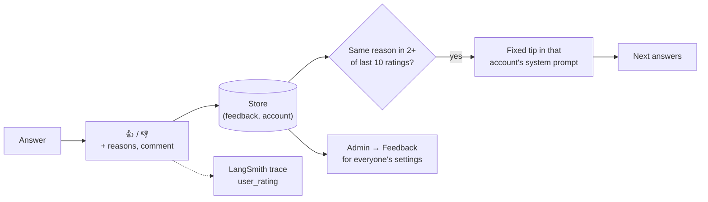

# How Markavi works

[← Back to the README](../README.md)

There are three parts.

## 1. The chat agent

A ReAct agent built with LangChain's `create_agent`. The model reads the
conversation, decides whether to call a tool, reads the result, and repeats
until it can answer. It handles the conversation: clarifying questions,
follow-ups, refusals and saving.

Its nine tools:

| Tool | Purpose |
|---|---|
| `create_market_report` | Runs the report workflow (below) |
| `web_search` | Market size, competitors, products, prices |
| `search_news` | News from the last month |
| `read_webpage` | Opens one page and reads all of it |
| `get_demand_trend` | Whether search interest is rising or falling |
| `get_company_financials` | Revenue, employees, founding year |
| `save_report` | Writes the latest report to a file |
| `remember_preference` | Saves a preference when you ask |
| `forget_preferences` | Deletes your saved profile |

## 2. The report workflow

A LangGraph graph with a fixed order of steps. The chat agent calls it as
one tool.

```
understand_request                     turn the request into local-language search words
        |
find_candidates                        search; list the companies the results name
        |
verify_competitor   (in parallel)      does it sell this product, in this country?
        |
select_competitors                     rank by mentions, keep the top five
        |
review_competitors                     PAUSE: you approve, edit or cancel
        |
        +-- research_competitor (in parallel)   figures; prices from the company's own site
        +-- research_market                     figures with the area and year they cover
        +-- research_news                       recent, relevant news
        +-- research_trend                      demand trend from a specific search word
        |
collect_facts
        |
write_swot    (retried once if incomplete)
        |
assemble_report                        build the text in code, then check it
```

Every step follows one pattern: **code gathers the material, the model does
one narrow job on it and answers in a fixed shape, and code checks the
answer before accepting it.**

Examples of those checks:

- A competitor's web address is accepted only if it was really in the
  search results and belongs to that company.
- A price is kept only if its number appears on the page that was read.
- A market figure is dropped if its number is not in the source it cites.
- Company figures are used only if the listed company's name starts with
  the brand name ("Factor" must not match "The Cheesecake Factory").

Sections 1 to 4 and 6 of the report are built by code from the checked
facts. Only the SWOT is written by the model, from those sections.

## 3. The web app

A Streamlit app, kept as a thin layer over the agent. It calls four
functions and contains no agent logic:

| Function | Used when |
|---|---|
| `stream_steps` | The user asks a question |
| `resume_steps` | The user submits an approval form |
| `pending_pause` | The page loads, to see if a form should be shown |
| `settle_stopped_turn` | The page loads, to tidy a run that was stopped half-way |

Streamlit reruns the page script on every click, so nothing important is
kept in the page. The conversation is read from the agent's saved state on
each run, and the conversation id lives in the page address. That is why a
refresh loses nothing.

Progress appears live because the report tool sends each step's line
through LangGraph's stream writer while it is still running.

**Numbered citations** are made by code, not by the model. The model
writes ordinary links; `agent/citations.py` replaces each with a number,
gives a page cited twice the same number, and builds the source list. Page
titles come from the search results that found them. A site is marked
Official when the report workflow confirmed it as a competitor's own, or,
for a single question, when the question names it.

**Stop** works because Streamlit ends the running script when any button
is pressed. A run cut off while a tool was working leaves the saved
conversation ending in a tool request with no result, which a model
refuses to continue from. `settle_stopped_turn` gives each open request
the result "stopped" the next time the page loads.

## Data sources and fallbacks

Each job has a list of sources, tried in order. The first that answers
wins, and the result says which one it was.

| Job | 1st | 2nd | 3rd |
|---|---|---|---|
| Web search | Tavily | Free metasearch (Bing, Yahoo, Google, DuckDuckGo) | Wikipedia |
| News | Tavily news | Google News | Metasearch news |
| Reading a page | Tavily Extract | Direct fetch | |
| Company figures | Yahoo Finance | Wikidata | |
| Demand trend | Google Trends | Wikipedia page views | |

All backups are free and need no key.

## Memory

| | Short-term | Long-term |
|---|---|---|
| Holds | The conversation, including reports | Your region, industry, business idea, report style |
| Scope | One conversation | All your conversations |
| LangGraph piece | Checkpointer | Store |
| Saved in | `data/memory.db` (SQLite) | `data/memory.db` (SQLite) |

## Middleware

Middleware is code that runs around the agent's model and tool calls.

| Middleware | What it does |
|---|---|
| `capture_profile` | Before answering, extracts lasting facts from your message and saves them |
| `prompt_with_profile` | Adds your saved profile, and the tips learned from your ratings, to the system prompt on every call |
| `require_country_from_user` | Blocks a market tool call for a country you never named |
| `ModelFallbackMiddleware` | Repeats a failed call with a backup model (off by default) |
| `HumanInTheLoopMiddleware` | Pauses for approval before a report is saved |

## Human-in-the-loop

Two approval points use the same LangGraph mechanism, an interrupt, set up
in two ways:

| | Competitor review | Save approval |
|---|---|---|
| Purpose | Quality: your judgement on the list | Safety: nothing is written without consent |
| How | An `interrupt()` call placed in the workflow | LangChain's ready-made middleware |
| In the app | A form with tick boxes | A form with an editable title |

While waiting, the state is saved, so you can close the page and answer
later. The workflow runs as a sub-graph that saves its own progress, so
continuing does not repeat the searches done before the pause.

## The feedback loop

Every answer can be rated 👍 or 👎. A 👎 asks what could be better: six
fixed reasons and a comment.



| Part | How it works |
|---|---|
| Saving | One rating per answer under ("feedback", account id), with the question, the model, style and length, and whether it was a report (`agent/feedback.py`) |
| Learning | `lessons()` looks at the account's last ten ratings. A reason given in two or more adds its tip; "Other" has none, and "Too long" with "Too short" cancel out. `prompt_with_profile` adds the tips after the profile and before the answer style |
| What reaches the prompt | Only five fixed sentences, one per reason. A typed comment never does, so it cannot steer the agent |
| Forgetting | Ten answers without a complaint push it out of the window, and its tip goes away |
| Switch | "Learn from feedback" on the Admin page, saved with the app settings; on at first |
| Admin | The Feedback tab: share helpful, 👎 and reasons, model × style compared, latest 👎 with comments (shown as text) |
| Dashboard | Each account's own share rated helpful |
| LangSmith | Each run gets an id chosen by the page. The rating is sent to that trace as `user_rating` (1 or 0) with the reasons and comment, in the background, and replaced when the rating changes (`agent/trace_feedback.py`) |